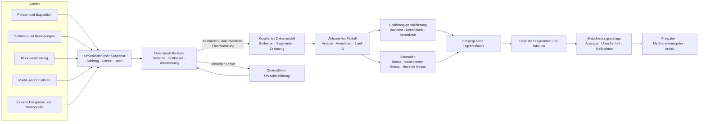

# Testplan für eine aktuarielle Risikobewertung

**Vom komplexen Rohdatenbestand zum prüfbaren, präsentierbaren Ergebnis**

**Stand:** 20. November 2026 · **Arbeitskontext:** Versicherung / Deutschland und EU

**Dokumenttyp:** Umsetzbarer Testplan und Präsentationsspezifikation

> **Zweck.** Dieses Dokument beschreibt, wie ein Testdatensatz, Datenpipeline, Risikomodell, Szenarioanalyse und die Ergebnisdarstellung gemeinsam geprüft werden. Es enthält außerdem geeignete öffentliche Testdatenquellen und einen Vorschlag für einen anspruchsvollen synthetischen Benchmark.
>
> **Abgrenzung.** Ohne konkrete Rohdaten, Produkt, Risikotyp und Verwendungszweck ist dies ein belastbarer Prüfrahmen, aber noch kein Ergebnis einer Risikobewertung und keine Konformitäts- oder Rechtsberatung. Für eine konkrete Einführung sind Rechtsraum, Sparte, Wesentlichkeit, interne Leitlinien und die jeweils gültigen Aufsichtsvorgaben zu bestätigen.

## 1. Kurzfassung und Qualitätsziel

Das Testziel ist eine durchgängige, nachvollziehbare Kette:

1. **Rohdaten verstehen:** Herkunft, Lizenz, Stichtag, Population, Definitionen und Einschränkungen dokumentieren.
2. **Daten kontrollieren:** Vollständigkeit, Exaktheit, Angemessenheit, Konsistenz, Zeitbezug, Verknüpfungen und Abstimmungen prüfen.
3. **Modell und Annahmen prüfen:** Eignung für den konkreten Zweck, Reproduzierbarkeit, Backtesting, Vergleichsmodelle, Sensitivität und Unsicherheit bewerten.
4. **Risiken herausfordern:** Basisfall, Einzel- und kombinierte Stressszenarien sowie Reverse-Stress-Tests durchspielen.
5. **Ergebnisse unabhängig plausibilisieren:** Fachliche Prüfung im Vier-Augen-Prinzip; Abweichungen, Einschränkungen und Modellgrenzen quantifizieren.
6. **Präsentation testen:** Jede Zahl bis zum Lauf und zur Datenquelle zurückverfolgen; Diagramme auf mathematische Richtigkeit, Verständlichkeit und Barrierearmut prüfen.
7. **Entscheidung ermöglichen:** Konsequenzen, Handlungsempfehlungen, Verantwortliche, Fristen und verbleibende Risiken klar benennen.

**Ergebnis ist freigabefähig**, wenn kein ungeklärter kritischer Fehler vorliegt, Daten- und Modellgrenzen offengelegt sind, die wesentlichen Ergebnisse reproduzierbar sind und alle dargestellten Kennzahlen mit dem freigegebenen Ergebnisdatensatz übereinstimmen.

Für die praktische Wiederverwendung sind ergänzend ein ausführbares synthetisches Set mit sauberen und fehlerhaften Fixtures sowie eine Anleitung zur Aufnahme weiterer Rohdaten verfügbar: [`Testset-README`](../data/synthetic/aktuariat-risikobewertung-v1/README.md) und [`Anleitung für Dritte`](anleitung-rohdaten-fuer-dritte.md).

**Wichtig zur Interpretation von Standards:** Es gibt nicht eine universelle Kennzahl oder Diagrammnorm, die für alle Aktuariate, Sparten und Modelle gilt. Rechtliche Pflichten, berufsständische Standards und interne Akzeptanzgrenzen sind auseinanderzuhalten. Die in diesem Plan genannten Grenzwerte sind daher **Vorschläge für interne Freigabegates**, keine pauschalen gesetzlichen Mindestwerte. Schwellen müssen vor Sichtung der Ergebnisse risikoprofil- und zweckgerecht festgelegt werden.

## 2. Prüfauftrag vor dem Datenimport festlegen

Vor dem ersten Lauf ist ein einseitiger Prüfauftrag („Run Charter“) auszufüllen. Ohne diese Festlegung sind Kennzahlen und Diagramme leicht missverständlich.

| Festlegung | Zu dokumentierende Antwort |
|---|---|
| Entscheidungsfrage | Welche konkrete Entscheidung soll die Bewertung unterstützen? Zum Beispiel Reservierung, Tarifierung, ORSA, Kapital-/Liquiditätsplanung oder Portfolio-Steuerung. |
| Risikoumfang | Sparte, Produkt, Gesellschaft/Gruppe, Länder, Segmente und betrachtete Risikoarten. Wesentliche Risiken begründen; nicht betrachtete Risiken ausdrücklich nennen. |
| Verwendungszweck | Externe Rechnungslegung, Aufsicht, interne Steuerung, Produktentwicklung, Forschung oder Training. Ein Modell darf nicht ohne Eignungsprüfung auf einen anderen Zweck übertragen werden. |
| Bewertungsstichtag | Datenstichtag, Bewertungsstichtag, Ereignisse nach dem Stichtag und Umgang mit Nachmeldungen. |
| Zeithorizont | Zum Beispiel ein Jahr für bestimmte Kapital-/Stressbetrachtungen oder mehrjährig für Geschäftsplanung/ORSA; Zweck und Abweichungen begründen. |
| Bewertungsbasis | Brutto/netto Rückversicherung, nominal/real, Zahlungs-/Schaden-/Bilanzsicht, Währung, Rechnungslegungs- und Aufsichtsperspektive. Diese Sichten nicht vermischen. |
| Modelle und Annahmen | Modellname, Version, Eigentümer, wesentliche Annahmen, Abhängigkeiten, bekannte Grenzen und Challenger-/Benchmarkmodell. |
| Wesentlichkeit | Vorab freigegebene quantitative und qualitative Schwellen, Eskalationsregeln und zuständige Freigabestelle. |
| Zielpublikum | Vorstand/Risikokomitee, Aktuariat/Validierung, Aufsicht, Fachbereich oder externe Prüfer. Je Zielpublikum eine passende Detailtiefe festlegen. |
| Datenklasse | Öffentlich, intern, vertraulich oder personenbezogen; Rechtsgrundlage, Zugriff und Aufbewahrung festlegen. |

### Risikokategorien als Startpunkt

Je nach Auftrag sind aus einer oder mehreren dieser Gruppen wesentliche Risiken aufzunehmen:

- **Versicherungstechnisch:** Schadenhäufigkeit und -höhe, Prämien- und Reserverisiko, Sterblichkeit/Langlebigkeit, Morbidität, Storno, Kosten, Konzentration, Rückversicherung und Groß-/Kumulschäden.
- **Markt und Bilanz:** Zins, Spread, Aktien, Währung, Inflation, Liquidität, Gegenparteiausfall und Aktiv-Passiv-Abhängigkeiten.
- **Szenarioübergreifend:** Naturkatastrophen, Klima-/Nachhaltigkeitsrisiken, Pandemie, Cyber-/Betriebsunterbrechung sowie Modell-, Daten- und Prozessrisiko.
- **Nicht quantifizierbare Risiken:** qualitative Beurteilung, Frühindikatoren, Kontrollmaßnahmen und verbleibende Unsicherheit dokumentieren; sie nicht künstlich in eine präzise Zahl pressen.

## 3. Regulatorischer und berufsständischer Maßstab

Für Deutschland/EU ist folgende Zuordnung ein praktikabler Ausgangspunkt. **Die Anwendbarkeit hängt von Unternehmen, Modellverwendung, Sparte und Berichtsregime ab.** Maßgeblich bleiben jeweils die aktuelle Fassung, nationale Umsetzung und unternehmensinternen Leitlinien.

| Rahmen | Was er für den Testplan bedeutet | Einordnung |
|---|---|---|
| **Solvency II**, insbesondere Richtlinie 2009/138/EG, Delegierte Verordnung (EU) 2015/35 und deutsches VAG | Governance, Risikomanagement, versicherungstechnische Rückstellungen, Kapitalanforderungen und ORSA in den anwendbaren Fällen. Daten, Annahmen, Verfahren und Berichte müssen zur jeweiligen Aufgabe passen und nachvollziehbar sein. | Verbindliche Aufsichtsvorgaben im jeweiligen Anwendungsbereich. [S1–S3] |
| **BaFin-MaGo für SII-Versicherer, Rundschreiben 09/2025 (VA)** | In Deutschland aktuelle BaFin-Auslegung zu Geschäftsorganisation und Schlüsselfunktionen. Die Fassung berücksichtigt unter anderem automatisierte Geschäftsabläufe und Nachhaltigkeit; ergänzende BaFin-Veröffentlichungen können für spezielle Themen relevant sein. | Für betroffene Unternehmen in der jeweils aktuellen Fassung prüfen; Proportionalität nach Risikoprofil beachten. [S4] |
| **EIOPA-Leitlinien zur ORSA** | Vorausschauende Beurteilung der Gesamtsolvabilität, geeignete Stress-, Sensitivitäts- und Szenarioanalysen; Datenstandards und Erläuterung, wie Ergebnisse in Entscheidungen einfließen. Die Leitlinien nennen grundsätzlich eine regelmäßige, mindestens jährliche Durchführung und eine erneute Beurteilung nach wesentlichen Änderungen des Risikoprofils. | Aufsichtliche Leitlinien und deren nationale Anwendung berücksichtigen; nicht bloß einen SCR-Wert reproduzieren. [S5] |
| **DAV-Fachgrundsätze / ISAP 1; bei Schadenreservierung zusätzlich DAV-Hinweis zu aktuariellen Aspekten der Schadenreservierung** | Ausreichende und verlässliche Daten, angemessene Datenvalidierung, Eignung des Modells für den Zweck, dokumentierte Unsicherheit, Prüfung von Methoden/Annahmen/Ergebnissen und Qualitätssicherung. | Berufsständische Anforderungen im jeweiligen fachlichen und persönlichen Anwendungsbereich; sie ersetzen keine Gesetze oder unternehmensinternen Anforderungen. [S6–S7] |
| **IFRS 17** | Nur wenn die Bewertung Teil der IFRS-Berichterstattung ist: Gruppenbildung und Bewertung von Versicherungsverträgen, explizite Risikoanpassung für nichtfinanzielles Risiko sowie Angaben zu Methoden und Risikoinformationen. | Rechnungslegungsbasis getrennt von Solvency-II-Kapital- und ORSA-Sicht darstellen; Risikoanpassung nach IFRS 17 ist nicht automatisch SCR oder Risikomarge. [S8] |
| **DSGVO/BDSG** | Bei personenbezogenen Daten: Zweckbindung, Datenminimierung, Zugriff, Pseudonymisierung/Anonymisierung, Aufbewahrung und gegebenenfalls Datenschutz-Folgenabschätzung. Keine identifizierbaren Kundendaten in öffentliche Testsets, Git-Repositories oder Präsentationen übernehmen. | Vor Nutzung interner Echtdaten mit Datenschutzverantwortlichen prüfen. [S9] |
| **EU-KI-Verordnung** | Bei KI-Systemen zur Risikobewertung und Preisbildung für natürliche Personen in der Lebens- oder Krankenversicherung ist insbesondere Anhang III, Nr. 5(c), zu prüfen. Zweckbestimmung, Einstufung, Datenqualität, Überwachung, menschliche Aufsicht und Übergangsregeln dokumentieren. Nicht jede Statistik oder jedes Modell ist automatisch gleich einzustufen. | Die Verordnung gilt grundsätzlich seit 2. August 2026; konkrete Klassifizierung und Übergangsbestimmungen rechtlich prüfen. [S10] |
| **DORA / IT- und Auslagerungsanforderungen** | Für relevante Finanzunternehmen auch digitale Betriebsresilienz, Zugriffe, Dienstleister, Änderungsmanagement, Wiederanlauf und Nachweisführung berücksichtigen. | Anwendbarkeit und Schnittstelle zu aktuellen BaFin-Anforderungen prüfen. [S11] |

### Regulatorische Versionskontrolle 2026/2027

Die Änderungsrichtlinie (EU) 2025/2 zur Solvency-II-Richtlinie ist in Kraft; die Mitgliedstaaten müssen sie bis **29. Januar 2027** umsetzen und die neuen Vorschriften sind ab **30. Januar 2027** anzuwenden. Für einen Testlauf im Übergang sind deshalb mindestens zwei Regelwerksstände festzuhalten: **am Bewertungsstichtag anwendbarer Stand** und, falls relevant, **zukünftiger Stand ab 30. Januar 2027**. Keine neue Regel rückwirkend auf eine frühere Bewertung anwenden, ohne dies ausdrücklich zu begründen. [S2]

## 4. Woher geeignete Testdaten kommen

Öffentliche Datensätze eignen sich zum Erproben von Import, Modellierung, Visualisierung und bekannten Randfällen. Sie sind **kein Ersatz** für unternehmensspezifische Daten und belegen keine regulatorische Angemessenheit. Lizenz, Version, Definitionen und Verzerrungen müssen je Quelle dokumentiert werden.

| Quelle | Was sich damit testen lässt | Grenzen / Hinweise |
|---|---|---|
| **CASdatasets: `freMTPL2freq` und `freMTPL2sev`** [S12] | Kfz-Haftpflicht: Policen-/Expositionsdaten, Schadenanzahl und zugehörige Schadenbeträge. Geeignet für Joins, Expositions-Offsets, Frequenz-/Schwere-Modelle, Segmentierung, Ausreißer, GLM/GLMM und Benchmark-Charts. | Französischer Bestand und älterer Beobachtungszeitraum; nicht ohne Weiteres auf Deutschland, aktuelle Tarife oder heutige Inflation übertragbar. Paketlizenz GPL (≥ 2); Lizenz des konkreten Datensatzes und Weiterverbreitung vor Verwendung prüfen. OpenML-Spiegel können abweichende Lizenzmetadaten führen; im Zweifel die ursprüngliche Quelle und Lizenz zugrunde legen. |
| **R-Paket `insuranceData` auf CRAN** [S13] | Sammlung klassischer Nichtleben-Datensätze für Frequenz-/Schwere- und Risikoklassifikationsmodelle; guter zusätzlicher Challenger für unterschiedliche Datenformen und Segmente. | Daten stammen aus unterschiedlichen Ländern/Zeiträumen und haben unterschiedliche Definitionen; Paketlizenz GPL-2. Ergebnisse nicht als aktueller Marktbenchmark darstellen. |
| **Eurostat-Lebenstafeln (`demo_mlifetable`)** [S14] | Aggregierte Sterblichkeit und Lebenserwartung nach Land, Alter, Geschlecht und Jahr; geeignet für Leben-/Langlebigkeits-Sensitivitäten und komplexe Zeitreihen-/Heatmap-Diagramme. | Nationale/aggregierte Demografie, keine individuellen Versicherungsverträge und kein Ersatz für unternehmensspezifische Rechnungsgrundlagen. Metadaten, Aktualisierungsstand und Nutzungsbedingungen beachten. |
| **Human Mortality Database (HMD/HLD)** [S15] | Vertiefte historische Sterblichkeits- und Bevölkerungstabellen, sofern Registrierung und jeweilige Nutzungsbedingungen erfüllt sind. Gut für Trend-, Kohorten- und Langlebigkeitsanalysen. | Nutzung unter den HMD-Bedingungen; Abdeckung und Vergleichbarkeit zwischen Ländern/Jahren prüfen. Keine individuellen Policen-/Schadendaten. |
| **EIOPA: risikofreie Zinsstrukturkurven** [S16] | Bewertung der Zinskurvenverarbeitung, Laufzeiten, Stichtage, Kurvenversionen und Zinsstress; geeignet für ALM-/Bewertungsdiagramme. | Offizielle technische Informationen verwenden und Lizenz-/Nutzungsbedingungen für Daten und gegebenenfalls Coding getrennt prüfen. Kein vollständiger Kapitalmarktdatensatz. |
| **EIOPA-Versicherungsstatistiken** [S17] | Aggregierter Plausibilitätsvergleich zu Bilanz, Eigenmitteln, Prämien, Schäden und Kapitalanforderungen auf Länder-/Marktebene. | Aggregatdaten, keine Policen- oder Schadenmikrodaten; ungeeignet, um ein individuelles Modell auf Mikroebene zu trainieren oder zu validieren. |
| **EIOPA Insurance Stress Test 2024** [S18] | Öffentliche technische Spezifikationen, Reportingtemplates und Ergebnisse als Referenz für Szenariodesign, Reportingstruktur, Kapital- und Liquiditätsdarstellung. | Keine frei verfügbaren Rohdaten einzelner Versicherer; Ergebnisse nicht als unternehmensindividuelle Kalibrierung verwenden. Auf der EIOPA-Seite nach dem jeweils neuesten Stress-Test-/Exploratory-Test-Material suchen. |
| **OpenFEMA: NFIP Redacted Claims v3 / NOAA Storm Events** [S19–S20] | Naturgefahren-/Flut- und Ereignisdaten: Ereignisverknüpfung, geographische Aggregation, Kumulschäden, Claims-Pipeline und Karten. | US-amerikanischer Versicherungs- und Deckungskontext, redigierte Ansprüche, keine direkte Kalibrierung für deutsche Naturgefahren. FEMA kennzeichnet den Claims-Datensatz als nicht zur Verwendung als offizieller Bundesbericht bestimmt. NOAA-Ereignisdaten sind keine Versicherungsschäden. Größen, Währung, Geographie und Erfassungsmethodik erklären. |
| **Kontrolliert synthetische Daten** | Beste Möglichkeit, bekannte „wahre“ Parameter, Randfälle, Abhängigkeiten, Datenschutz und gezielte Datenfehler kontrolliert zu testen. | Synthetische Daten bilden die Realität nicht automatisch ab; Generator, Annahmen, Zufalls-Seed, bekannte Grenzen und „ground truth“ offenlegen. Nicht als Echtdaten ausgeben. |

### Empfohlenes anspruchsvolles Testset

Für ein umfassendes Übungsprojekt sollte ein reproduzierbarer synthetischer Datensatz mit separaten Tabellen erstellt werden. Die folgenden Größen sind **illustrative Größenordnungen für einen anspruchsvollen Test**, keine aufsichtsrechtlichen Mindestwerte. Für Reservierungsanalysen sind ausreichend viele Schaden- und Abwicklungsjahre wichtiger als eine bloß große Zeilenzahl.

| Tabelle / Artefakt | Empfohlene Inhalte |
|---|---|
| `policy_exposure` | Illustrativ 200.000–500.000 Policen-/Jahres- oder Deckungsabschnitte; Beginn/Ende, anteilige Exposition, Produkt, Region, Risikomerkmale, Prämie, Währung, Status und Rückversicherungsschutz. |
| `claim_header` | Illustrativ 30.000–80.000 Schadenfälle; Schaden-, Melde- und Abschlussdatum, Ursache, Schadenart, Segment, Verknüpfung zur Police und Großschaden-/Katastrophenkennzeichen. |
| `claim_transaction` | Teilzahlungen, Fallreserven, Wiedereröffnungen, Korrekturen, Rückflüsse/Regresse, Reservierungsstichtag, Transaktionsdatum und Währung. Mehrere Bewegungen je Schadenfall erzeugen realistische Abwicklungshistorien. |
| `development_view` | Bei Reservierung mindestens mehrere Schaden-/Abwicklungsjahre in einer versionierten Zahlungs- und/oder Incurred-Sicht; diagonale, fehlende und verspätete Meldungen bewusst abbilden. Die benötigte Historie hängt von Sparte, Tail und Methode ab. |
| `reinsurance` | Vertrag, Quote/Layer, Selbstbehalt, Limit, Wiederauffüllung, gültige Periode, Zession, Rückversicherer und Ausfall-/Streitfallannahmen. Brutto und netto getrennt berechnen. |
| `market_curve` | Monatliche oder tägliche Marktinputs mit Stichtag, Währung, Laufzeit, Zins-/Spreadkurve und Szenarioversion. EIOPA-Kurve als dokumentierte Referenz verwenden, falls passend. |
| `cat_event_exposure` | Ereignis-ID, Gefahrenart, Region, Zeitraum, betroffene Exposition, Schadenstatus und Kumulschaden; externe Ereignisquelle getrennt von Versicherungsclaims halten. |
| `reference_data` | Versionierte Codes, Währungskurse, Geographie, Produkt-/Segmentmapping, Kalender, Inflationsannahmen, Annahmen- und Regelwerksversionen. |
| `ground_truth` | Nur für synthetische Daten: versteckte/gesonderte Generatorparameter, erwartete Frequenz, Schwere, Ultimates, Abhängigkeiten und Szenarioeffekte. Nicht als Modellinput freigeben. |
| `defect_catalog` | Liste kontrolliert eingebauter Fehler mit Zeilen-/Segmentbezug, Schweregrad, erwarteter Erkennung und erwarteter Behandlung. |

**Gezielt einbauen:** hohe Schwere-Tails, Mehrfachschäden, ungleiche Expositionsdauern, saisonale Effekte, korrelierte Risikomerkmale, fehlende Werte nicht zufällig, nachgemeldete/offene Schäden, Schadeninflation/Strukturbruch, seltene Großschäden, Kumulereignisse, Währungs-/Einheitenfehler, verspätete Buchungen, doppelte Bewegungen, verwaiste Schlüssel, wechselnde Codes und geänderte Datenquellen. Die Fehler im Testset müssen bekannt sein; fehlerhafte Daten sollen nicht unbemerkt „bereinigt“ oder stillschweigend aus dem Ergebnis entfernt werden.

## 5. Daten- und Modellfluss

Der nachfolgende Ablauf ist zugleich ein Diagramm-Entwurf für die Dokumentation. Jede Kante muss eine dokumentierte Transformation besitzen; jeder Gate-Fehler muss einen Status und eine verantwortliche Stelle erhalten.



## 6. Testkatalog

### 6.1 Teststatus und Priorität

- **P0 / kritisch:** Fehler kann Ergebnis, Sicherheit, regulatorische Aussage oder Entscheidung wesentlich verfälschen. Muss vor Freigabe behoben oder durch zuständige Stelle ausdrücklich als unzulässig bewertet werden.
- **P1 / hoch:** Wesentliche Einschränkung; Freigabe nur mit quantifizierter Auswirkung, dokumentierter Begründung, Eigentümer und Frist.
- **P2 / mittel/niedrig:** Verbesserungsbedarf ohne nachgewiesene wesentliche Ergebniswirkung; in Maßnahmenliste aufnehmen.
- Teststatus: **nicht gestartet**, **bestanden**, **bestanden mit Einschränkung**, **nicht bestanden** oder **blockiert**. „Bestanden mit Einschränkung“ ist kein Ersatz für eine Freigabeentscheidung.

### 6.2 Testfälle

| ID / Prio | Test | Vorgehen und erwartetes Ergebnis | Nachweis |
|---|---|---|---|
| DQ-01 / P0 | Herkunft, Berechtigung und Version | Quelle, verantwortliche Stelle, Lizenz/Nutzungsrecht, Stichtag, Datenwörterbuch, Download-/Extraktionsdatum und Prüfsumme erfassen. Nicht freigegebene Quelle blockiert den Lauf. | Data Card, Quellmanifest, Hashes |
| DQ-02 / P0 | Schema, Typen und Einheiten | Erwartete Felder, Datentypen, Einheiten, Währungen, Nullcodes und Schemaänderungen prüfen. Euro/Cent- oder Prozent-/Basispunkt-Verwechslung muss erkannt werden. | Schema-Testbericht, Mapping |
| DQ-03 / P0 | Schlüssel und Verknüpfungen | Eindeutigkeit der Schlüssel, Kardinalitäten und Referenzintegrität zwischen Police, Schaden, Bewegung, Rückversicherung und Ereignis testen. Duplikate und verwaiste Datensätze quantifizieren/quarantänisieren. | Join- und Duplikatbericht |
| DQ-04 / P0 | Fachliche Zeit- und Wertebereiche | Beginn ≤ Ende; Meldung nicht vor Schadenereignis ohne begründete Ausnahme; positive Exposition; Beträge/Währungen, Alter und Status nach Geschäftsregeln plausibilisieren. Fehler nicht stillschweigend auf null setzen. | Regelverletzungen, Ausnahmeprotokoll |
| DQ-05 / P0 | Abstimmung und Vollständigkeit | Policen-/Expositionssummen, Prämien, Schadenbewegungen, Rückversicherung und geeignete Buchungs-/Meldewesen-Kontrollsummen abstimmen. Abweichungen je Stichtag und Segment erklären. | Abstimmungsbrücke mit Toleranz |
| DQ-06 / P1 | Angemessenheit und Missingness | Fehlwerte, Ausreißer, nicht abgedeckte Segmente, Zeitlücken und Datenrepräsentativität nach Risikotreiber untersuchen. Zufällige und systematische Ausfälle unterscheiden; Ergebniswirkung quantifizieren. | Qualitätskennzahlen je Feld/Segment |
| DQ-07 / P0 | Injektions-/Negativtests | Im Testdatensatz bekannte Fehler (Duplikate, fehlende IDs, falsche Währung, falsche Zeitfolge, fehlende Kategorie, gekappte Großschäden) einspielen. Jede Fehlerklasse muss wie spezifiziert erkannt, klassifiziert und behandelt werden. | Defektkatalog mit Soll/Ist-Erkennung |
| DQ-08 / P0 | Datenschutz und Zugriff | PII-/Geofeld-Scan, Berechtigungen, Protokollierung, Pseudonymisierung, Lösch-/Aufbewahrungsregeln und Exportkontrolle testen. Öffentliche Testartefakte dürfen keine identifizierbaren Echtdaten enthalten. | Datenschutz-/Zugriffsprüfung |
| DQ-09 / P1 | Lineage und Wiederholbarkeit | Rohbestand, Transformationen und abgeleitete Features bis zu Quellfeld und Codeversion zurückverfolgen. Gleicher Snapshot, Code, Parameter und Seed müssen denselben Ergebnislauf erzeugen oder zulässige numerische Toleranzen begründen. | Lineage-Graph, Run-Manifest |
| MV-01 / P0 | Zweckmäßigkeit und Modellkonzeption | Zielgröße, Population, Beobachtungsfenster, Exposition, Modellannahmen und Einsatzgrenzen vorab festlegen. Prüfen, ob Methode für Sparte, Daten und Entscheidung sachlich geeignet ist. | Modellkarte, unabhängiges Review |
| MV-02 / P1 | Benchmark / Challenger | Gegen eine transparente Baseline (z. B. aggregierte Rate, GLM oder aktuelles freigegebenes Modell) und, soweit sinnvoll, ein Challenger-Modell vergleichen. Verbesserung im relevanten Zielmaß und Nebenwirkungen je Segment dokumentieren. | Vergleichsbericht mit Metrikdefinitionen |
| MV-03 / P0 | Schadenfrequenz, Schwere und Prämie | Frequenz mit geeigneter Exposition/Offset und Schwere getrennt bewerten; dann Aggregat/Pure Premium gegen konsistenten Bestand prüfen. Für Verteilungen passende Alternativen testen (z. B. Poisson/Negativ-Binomial, Gamma/Lognormal/Pareto oder Tweedie). | O/E, A/E, Residuen, Kalibrierung |
| MV-04 / P1 | Reservierung (falls im Umfang) | Zahlungs- und/oder Incurred-Dreiecke fachlich abstimmen; z. B. Chain-Ladder, Bornhuetter-Ferguson und Bootstrap als Vergleich prüfen. Stichtagsnahe Holdouts und ultimative Abwicklung nutzen; Segmentierung, Tail und Änderungen dokumentieren. | Dreiecke, Ultimates, Backtest, Range |
| MV-05 / P0 | Zeitliche Out-of-sample-Prüfung | Zeitbasierte Trainings-/Validierungs-/Testperioden verwenden. Keine zukünftigen Informationen, nachträglichen Buchungen oder Ereigniskennzeichen in historische Features leaken lassen. Ereignisse/Policen gemeinsam halten, wo sonst Gruppenkontamination entsteht. | Split-Definition, Leakage-Tests |
| MV-06 / P1 | Kalibrierung, Residuen und Unsicherheit | Prognose gegen Istwerte insgesamt und nach wesentlichen Segmenten prüfen; systematische Unter-/Überschätzung, Kalibrierung, Residuen und Vorhersage-/Konfidenzintervalle bewerten. Tail-Risiken separat behandeln. | Kalibrierungsplots, Intervallabdeckung |
| MV-07 / P1 | Stabilität und Robustheit | Sensitivität gegen Datenstichtag, Segmentierung, Ausreißerbehandlung, Annahmen, Inflations-/Trendparameter und plausible Modellalternativen testen. Strukturbrüche und Modell-/Datenänderungen erklären. | Sensitivitätstabelle, Change Log |
| MV-08 / P1 | Modellrisiko und Grenzen | Modellkonzeption, Datenverfügbarkeit/-granularität, Abhängigkeiten, Parameter- und Prozessrisiko, Aggregationsgrenzen sowie Modellvereinfachungen unabhängig challengen. | Modellrisikoregister, Limitations |
| ST-01 / P0 | Szenarioabdeckung | Wesentliche Risiken den Szenarien zuordnen; Basis, adverse, kombinierte und — wo zweckmäßig — Reverse-Stress-Szenarien testen. Für jeden Schock Quelle, Stichtag, Dauer, Auswirkungspfad und Plausibilität dokumentieren. | Szenariokatalog, Zuordnungsmatrix |
| ST-02 / P0 | Abhängigkeiten und Kumul | Gemeinsame Ereignisse, Abhängigkeiten und Konzentrationen testen; prüfen, ob Korrelation/Tail-Dependence oder eine bewusst konservative Vereinfachung vorliegt. Unabhängige Einzelstresswerte nicht unkritisch addieren. | Aggregationsbrücke, Abhängigkeitsannahmen |
| ST-03 / P1 | Reverse Stress | Kritische Zielverletzung vorab definieren (z. B. Risikoappetit-/Kapital- oder Liquiditätsgrenze) und Kombinationen identifizieren, die sie auslösen. Ergebnis als Schwellen-/Pfad- und nicht nur als Punktzahl darstellen. | Reverse-Stress-Pfad, Frühindikatoren |
| ST-04 / P0 | Finanzielle / aufsichtsrechtliche Abstimmung | Wenn im Auftrag: Ergebnis mit passender Bilanz-/Kapital-/Meldeperspektive abstimmen. Brutto/netto, Steuern, Rückversicherung, Managementmaßnahmen und Bewertungsbasis separat ausweisen. SCR, IFRS-17-Werte und interne Risikowerte nicht gleichsetzen. | Überleitung mit Vorzeichen und Einheiten |
| ST-05 / P1 | Managementmaßnahmen | Wirkungen nur berücksichtigen, wenn Auslöser, Entscheidungsbefugnis, Umsetzbarkeit, Zeitverzug, Kapazität und Nebenwirkungen plausibel sind. Ergebnis mit und ohne Maßnahmen zeigen. | Aktionsregister, Brutto-/Netto-Vergleich |
| ST-06 / P1 | Backtesting der Projektionen | Frühere Prognosen/Szenarien gegen eingetretene Werte vergleichen; Datenstichtag und damals bekannte Informationen rekonstruieren. Bias, Fehlerband und daraus gezogene Modell-/Managementmaßnahmen festhalten. | Prognose-Ist-Brücke, Lernpunkte |
| GOV-01 / P1 | Subgruppen-/Fairnessprüfung | Bei personenbezogener Tarifierung/Entscheidung: geeignete, rechtlich geprüfte Subgruppen- und Wirkungsanalyse durchführen; Proxy-Variablen und Datenherkunft untersuchen. Unzulässige Merkmale nicht allein aus statistischer Verfügbarkeit verwenden. | Compliance-/Rechtsreview, Segmentanalyse |
| GOV-02 / P0 | Änderungs- und Modellinventar | Code, Bibliotheken, Daten, Annahmen, Modellversion, Seed, Laufparameter, Freigabe, Nutzer und Änderungen unveränderbar protokollieren. | Modellinventar, Run-Manifest |
| REP-01 / P0 | Zahlentreue von Tabellen und Charts | Kennzahlen aus freigegebener Ergebnisbasis erzeugen; Summe, Rundung, Einheit, Stichtag und Definition zwischen Tabelle, Diagramm und Text automatisch/prüfbar abstimmen. | Chart-to-table-Abstimmungsbericht |
| REP-02 / P1 | Diagrammverständlichkeit | Prüfen, ob Leitfrage, Kernaussage, Basis, Einheiten, Nenner, Zeitraum, Unsicherheit und Segmentumfang im Diagramm oder in einer unmittelbar zugeordneten Notiz klar sind. | Präsentationsreview mit Zielpublikum |
| REP-03 / P1 | Reproduzierbare Ausgabe | Quelldaten/Run-ID, Code-/Modellversion und Chartdaten je Grafik referenzieren. Für Print SVG/PDF oder ausreichend hoch aufgelöste Exporte; editierbare Quelle und finale PDF-Version archivieren. | Artefaktmanifest |
| REP-04 / P1 | Barrierearmut und Lesbarkeit | Farbfehlsichtigkeit, Kontrast, Schriftgröße, Beschriftungen und Alternativtext prüfen. Rote/grüne Farbe nie als einziges Statussignal verwenden. | Accessibility-Checkliste |

## 7. Kennzahlen und Szenariobibliothek

### 7.1 Kennzahlen vor dem Rechnen definieren

Alle Kennzahlen erhalten **Formel, Einheit, Stichtag, Population, Brutto-/Netto-Sicht, Zeithorizont, Segment und Behandlung von Ausreißern**. Ein mögliches Definitionsblatt:

- **Schadenfrequenz:** Schadenanzahl geteilt durch konsistent definierte Exposition (z. B. Policenjahre); Meldedefinition und Mehrfachschäden festlegen.
- **Schadenschwere:** Ultimate- oder gezahlter Schadenbetrag geteilt durch Schadenanzahl; nur auf denselben Schadenbestand und dieselbe Basis beziehen.
- **Pure Premium / Schadenbedarf:** erwarteter Schadenbetrag pro Exposition. In konsistenter Abgrenzung gilt Frequenz × Schwere = Schadenbedarf.
- **A/E bzw. O/E:** Ist- zu Erwartungswert; bei Nullnenner und Aggregation eine vorab definierte Behandlung verwenden.
- **VaR/TVaR:** Konfidenzniveau, Verlustdefinition, Bewertungsbasis und Horizont immer nennen; „99,5 %“ ohne Kontext ist nicht ausreichend.
- **Reserveabweichung:** Prognose- und Ist-Definition, Entwicklungsstichtag und Vorzeichen dokumentieren; Zahlungs- und Incurred-Sicht nicht vermischen.
- **Solvenz-/Kapitalquote:** verwendete Definition und Datenquelle nennen; Stresswirkung sowohl auf Zähler als auch Nenner zeigen.

Geeignete Gütemaße hängen von Ziel und Verteilung ab. Ein einzelner Gesamtwert (z. B. R² oder Gini) beweist weder Kalibrierung noch Tail-Güte oder Segmentstabilität. Für Zählmodelle, Schwere, Aggregatverluste, Reserven und Klassifikationen jeweils passende Gütemaße und Diagnostik wählen.

### 7.2 Szenariofamilien

Die Größenordnung der Schocks ist **nicht pauschal vorzugeben**. Regulatorisch vorgeschriebene Parameter sind in ihrem Anwendungsbereich exakt und versioniert anzuwenden. Andere Szenarien sind anhand des Risikoprofils, historischer Daten, Marktinformationen und nachvollziehbarer Expertenurteile zu kalibrieren.

| Familie | Beispiele für Szenarien und Auswertungen |
|---|---|
| Schadeninflation/Reserve | Höhere als erwartete Schadenkosten, verzögerte Abwicklung, Verschlechterung langer Tails, Großschadenhäufung; Ultimate- und Reserveband, Ergebnis und Kapitalwirkung. |
| Naturkatastrophe/Kumul | Ein Ereignis sowie mehrere Ereignisse innerhalb des relevanten Zeitfensters; geographische Konzentration, Rückversicherungsdeckung, Wiederauffüllung und Nettoschaden. |
| Markt/ALM | Zinsanstieg und -rückgang, Spread-Ausweitung, Aktienrückgang, Währungsbewegung, Gegenparteiausfall und Liquiditätsabfluss; Aktiv-/Passivwirkung gemeinsam zeigen. |
| Leben/Kranken (falls relevant) | Sterblichkeits- oder Langlebigkeitsverschiebung, Morbidität/Pandemie, Storno/Massenstorno, Kosteninflation und Verhaltensoptionen. |
| Rückversicherung | Ausfall, Streit, verspätete Zahlung, weniger verfügbare Kapazität oder veränderte Konditionen bei Erneuerung. |
| Betrieb/Cyber | Ausfall einer Kernplattform, Datenkorruption, Cybervorfall, Dienstleisterunterbrechung und längerfristiger Wiederanlauf. Auswirkungen auf Berechnung, Zahlung und Bericht mitbewerten. |
| Klima/ESG | Physische Risiken (akut/chronisch) und Übergangsrisiken getrennt modellieren; kurze Stresshorizonte und längere Geschäftsmodell-/Strategiehorizonte nicht in einem Diagramm vermengen. 2026 veröffentlichte gemeinsame ESG-Stresstest-Leitlinien richten sich an zuständige Behörden und können als Aufsichtskontext, nicht als mechanische Einheitskalibrierung, dienen. [S21] |
| Kombination/Reverse Stress | Mehrere gleichzeitige, fachlich begründete Schocks; zusätzlich die Kombination bzw. Schwelle suchen, bei der eine vorab definierte Risikoappetit-, Liquiditäts- oder Kapitalgrenze verletzt würde. |

Mindestens je Szenario dokumentieren: Name/ID, Bewertungsdatum, Ausgangslage, Schockpfad, Horizont, Begründung, Quellen, Abhängigkeiten, Managementmaßnahmen, Unsicherheit, Modellgrenzen und betroffene Kennzahlen. Ausgaben nach Möglichkeit für **Basis**, **Stress ohne Managementmaßnahmen** und **Stress mit plausiblen Maßnahmen** vergleichen.

### 7.3 Ergebnisüberleitung

Jeder wesentliche Effekt lässt sich von der Basis zum Stress nachvollziehen, etwa:

`Basis → Markt-/Schaden-/Stornoeffekt → Diversifikation/Abhängigkeiten → Rückversicherung/Steuern → Managementmaßnahmen → Endwert`

Die Brücke muss Vorzeichen und Einheiten je Schritt erklären. Verbleibende Differenzen kommen in eine eigene Zeile „nicht zugeordnet“ und werden bis zur Freigabe geklärt oder ausdrücklich als Einschränkung behandelt.

## 8. Freigabegates und Verantwortlichkeiten

### 8.1 Vorgeschlagene Freigabegates

| Gate | Freigabekriterium | Ergebnis bei Nichterfüllung |
|---|---|---|
| **G0 – Auftrag** | Zweck, Risiko, Bewertungsbasis, Stichtag, Nutzer, Wesentlichkeit und Regelwerksstand schriftlich freigegeben. | Kein produktiver Modell-/Präsentationslauf. |
| **G1 – Daten** | Quellenrechte und Lineage sind bekannt; kritische Schlüssel-, Zeit-, Einheiten- und Abstimmungsfehler sind behoben oder ihre Auswirkung ist quantifiziert; keine stille Bereinigung. | P0-Fehler blockiert; Einschränkung mit Eigentümer und Frist genehmigen lassen. |
| **G2 – Modell** | Fachliche Eignung, Out-of-time-Test, Vergleich/Benchmark, Sensitivität und Grenzen sind geprüft; interne Akzeptanzschwellen wurden vor Ergebnisprüfung festgelegt. | Keine Modellfreigabe für den angegebenen Zweck. |
| **G3 – Szenario/Interpretation** | Wesentliche Risiken abgedeckt; Schocks begründet; Kumul-/Abhängigkeitsannahmen und Managementmaßnahmen challengt; Überleitung ist geschlossen. | Szenario oder Aussage neu rechnen bzw. als nicht entscheidungsreif kennzeichnen. |
| **G4 – Ergebnisdarstellung** | Alle Diagramme stimmen mit freigegebenen Daten überein; Definition, Einheit, Basis, Stichtag, Unsicherheit und Grenzen sind erkennbar. | Darstellung korrigieren; nicht mit ungeprüften Grafiken präsentieren. |
| **G5 – Freigabe/Archiv** | Aktuarielle und unabhängige Prüfung, erforderliche Risiko-/Compliance-/Datenschutzfreigaben sowie Managemententscheidung dokumentiert; alle Artefakte versioniert archiviert. | Keine Veröffentlichung oder Verwendung als freigegebenes Ergebnis. |

**Interne Mindestvorschläge:** keine offenen P0-Fehler; 100 % der kritischen Kennzahlen und Diagramme mit freigegebener Ergebnisbasis abstimmen; jede fehlende oder ungeeignete Datenkomponente mit möglicher Ergebniswirkung beziffern; jede wesentliche Modelländerung unabhängig prüfen; keine Managementmaßnahme ohne dokumentierte Umsetzbarkeit. Für konkrete Performance-, A/E-, Intervallabdeckungs- oder Datenqualitätsgrenzen sind vorab populations- und entscheidungsspezifische Toleranzen zu beschließen. Ein universeller Prozentsatz ist nicht sachgerecht.

### 8.2 Rollen (RACI-Vorschlag)

| Rolle | Verantwortung |
|---|---|
| Auftraggeber / zuständige Leitung | Entscheidungsfrage, Wesentlichkeit, Risikoappetit und endgültige Entscheidung. |
| Aktuarielle:r Modellverantwortliche:r | Methode, Annahmen, Berechnung, fachliche Interpretation und Modellkarte. |
| Datenverantwortliche:r / Data Steward | Quellzugang, Definitionen, Lineage, Datenqualitätsregeln, Korrekturen und Kontrollsummen. |
| Unabhängige Validierung / Peer Reviewer | Unabhängige Prüfung von Daten, Methode, Backtest, Grenzen, Szenarien und Ergebnissen. Mindestens Vier-Augen-Prinzip; Unabhängigkeit angemessen zum Risikoprofil ausgestalten. |
| Risikomanagement / ORSA | Risikoinventar, Szenariorelevanz, Risikoappetit, Zusammenführung und Entscheidungsbezug. |
| Compliance / Recht / Datenschutz | Anwendbarkeit, personenbezogene Merkmale, KI-Einstufung, Nutzungsrechte und externe Aussagen prüfen. |
| Bericht-/Visualisierungsteam | Verständliche und barrierearme Aufbereitung aus freigegebener Ergebnisbasis; keine manuelle Neuinterpretation von Zahlen. |

## 9. Präsentationsanforderungen

### 9.1 Format und Zielpublikum

- **Managementfassung:** Vorschlag 10–12 Folien, 16:9, ca. 15–20 Minuten plus Fragen. Jede Folie trägt eine Aussage im Titel; nicht nur ein Thema.
- **Technischer Anhang:** Datenwörterbuch, Quellen-/Lizenzkarte, Qualitätsbericht, Formeln, Modell- und Szenariodokumentation, Testprotokolle, Unsicherheiten und vollständige Tabellen.
- **Abgabe:** editierbare Quelldatei plus PDF; Diagramme möglichst vektorbasiert (SVG/PDF) oder für den vorgesehenen Druck ausreichend hoch aufgelöst. Jede freigegebene Version besitzt Datum, Autor:in, Version, Klassifizierung und Run-ID.
- **Zielgruppen getrennt bedienen:** Entscheidungsträger erhalten Resultat, Wesentlichkeit und Maßnahme; Aktuar:innen/Validierende erhalten Methodik, Annahmen und Diagnose; Aufsicht/Prüfung erhält zusätzlich Datenherkunft, Kontrollen und Audit Trail.
- **Kennzeichnung:** Bei Übungs-/synthetischen Daten auf Titelfolie und Ergebnisfolien sichtbar **„Testdaten / synthetisch – kein tatsächlicher Solvenz- oder Unternehmensbefund“** angeben.

### 9.2 Empfohlener Folienablauf

1. **Titel und Entscheidung:** Auftrag, Stichtag, Risikobereich, gewünschte Entscheidung.
2. **Executive Summary:** Drei bis fünf Kernaussagen, wichtigste Risikozahl(en), größte Unsicherheit und konkrete Empfehlung.
3. **Scope und Wesentlichkeit:** Population, Segmentierung, Brutto/netto, Horizont, Abgrenzungen und nicht betrachtete Risiken.
4. **Daten und Qualität:** Quellen, Historie, Datenqualität, bekannte Lücken, Anpassungen und Ergebniswirkung.
5. **Methode und Validierung:** Modell/Benchmark, Holdout, zentrale Annahmen, Backtesting und unabhängige Prüfung.
6. **Basisfall:** Exposition und zentrale Ist-/Erwartungswerte inklusive Einheit, Umfang und Unsicherheitsband.
7. **Szenariovergleich:** Basis vs. adverse Szenarien; Auswirkungen auf die entscheidungsrelevanten Kennzahlen.
8. **Treiber und Überleitung:** Welche Risiko-/Geschäftstreiber erklären die Veränderung? Beitrag und Vorzeichen auflösen.
9. **Unsicherheit/Tail:** Verteilung, Prognoseband, Sensitivität, Konzentration, Tail-Risiko und Modellgrenzen.
10. **Segmente/Konzentration:** Wesentliche Produkt-, Geo-, Kohorten- oder Risikogruppen; geeignete Nenner und Fallzahlen ausweisen.
11. **Maßnahmen:** Maßnahme, erwartete Wirkung, Eigentümer, Frist, Vorbedingung und verbleibendes Risiko.
12. **Entscheidung und Anhang:** Freigabevorschlag, Vorbehalte und Verweis auf Methodik-/Testanhang.

Je nach Zielpublikum können Folien zusammengelegt oder erweitert werden. Eine kurze Managementfassung darf jedoch keine wesentliche Unsicherheit oder Grenze ausblenden.

### 9.3 Diagrammportfolio für komplexe Ergebnisse

| Diagramm | Einsatz | Pflichtangaben / Vorsicht |
|---|---|---|
| **Schadenentwicklungsdreieck als Heatmap** | Paid-/Incurred-Entwicklung und auffällige Zellen/Jahre. | Schadenjahr/Abwicklungsalter, Einheit, Stichtag und fehlende/späte Zellen klar markieren; keine Farbskala ohne Zahlen- oder Legendenbezug. |
| **Schadenfrequenz/-schwere nach Segment** | Risikotreiber in Produkt, Alter, Region oder Fahrzeugklasse. | Exposition, Fallzahl, Konfidenz-/Credibility-Hinweis und Segmentdefinition einblenden; kleine Segmente nicht überinterpretieren. |
| **Verteilung und Exceedance-Kurve** | Schwere/Tail, VaR und TVaR. | Verlustdefinition, Brutto/netto, Horizont, Konfidenzniveau, Stichproben-/Simulationsumfang und Schätzunsicherheit angeben. |
| **Waterfall / Brückenplot** | Basis-zu-Stress-Überleitung, Rückversicherung, Steuern und Maßnahmen. | Beiträge additiv abstimmen; Vorzeichen, Basis und Rundung sichtbar halten; Differenz nicht verstecken. |
| **Tornado-/Sensitivitätsdiagramm** | Einzelfaktor- und Parameterwirkung. | Schockgröße, Richtung, Einheit, Bezugspunkt und symmetrische/asymmetrische Annahmen angeben; bei Interaktionen ergänzende Szenariomatrix zeigen. |
| **Szenariomatrix als Heatmap** | Kombination aus Risiko und Szenario, mehrere Ergebniskennzahlen. | Absolute Werte oder Veränderung gegenüber Basis klar unterscheiden; Farbgrenzen dokumentieren; Null, negativ und fehlend unterschiedlich codieren. |
| **Fan Chart / Unsicherheitsband** | Mehrjährige Entwicklung oder Prognoseintervall. | Median/Erwartungswert, Banddefinition/Quantile, Stichtag und Projektion klar kennzeichnen; nicht als sichere Vorhersage darstellen. |
| **Konzentrations-/Geokarte** | Kumul- und regionale Gefahren. | Exposition und Schadenrate getrennt kartieren; Aggregationsebene und Datenschutz prüfen; gleiche Skalen für Vergleiche nutzen. |
| **Risiko-Heatmap** | Managementübersicht qualitativer und quantitativer Risiken. | Eintritt und Auswirkung definieren; subjektive Scores als qualitative Einschätzung markieren; eine Heatmap ist keine Kapitalmessung. |
| **Zeitreihe / Solvenztrajektorie** | Verlauf von Bestand, Kapital, Liquidität oder Schäden. | Bewertungs-/Meldezeitpunkte, nominal/real, Sprünge und methodische Änderungen erläutern; Plan/Actual sauber unterscheiden. |

**Diagrammregeln für jede Folie:**

- Aussageorientierter Titel („Schadeninflation erklärt den größten Teil des Stressanstiegs“ statt „Stressszenario“).
- Achsen, Einheit, Währung, Zeitraum, Stichtag, Nenner, Segment, Basisfall und relevante Fallzahl nennen.
- Quelle, Run-ID und Berechnungsdefinition direkt am Diagramm oder in eindeutig zugeordneter Fußnote angeben.
- Unsicherheit und Datenlücken sichtbar machen; Rundung und Unterdrückung kleiner Segmente erklären.
- Farbfehlsichtigkeitsfreundliche Palette, ausreichend Kontrast, verständliche Legende und Alternativtext. Farbe nicht als einziges Signal verwenden.
- 3D-Effekte, dekorative Diagramme, unkommentierte Doppelachsen, abgeschnittene Nullachsen bei Balkendiagrammen sowie irreführende Prozent-/Absolutvergleiche vermeiden.
- Für komplexe Darstellungen: erst Überblick, danach gezielte Detailansicht; Filter, Drill-down oder mehrere Teilgrafiken nur dann, wenn jede Ansicht eine konkrete Frage beantwortet.
- Diagramme programmatisch aus der freigegebenen Ergebnistabelle erzeugen; Werte nicht manuell in Grafiksoftware übertragen.

## 10. Dokumentationspaket und Abschlusschecklisten

### 10.1 Mindestpaket je freigegebenem Lauf

1. Run Charter und anwendbarer Regelwerksstand.
2. Datenkarte: Quelle, Lizenz, Version, Zeitraum, Population, Definitionen, Bias und Transformation.
3. Unveränderlicher Snapshot/Manifest (Prüfsumme statt Kopie vertraulicher Daten im Bericht).
4. Schema, Datenwörterbuch, Qualitäts- und Abstimmungsberichte mit offenen Ausnahmen.
5. Modellkarte: Zweck, Methode, Features, Annahmen, Grenzen, Versions- und Änderungsprotokoll.
6. Validierungsbericht: Testfälle, Holdout, Benchmarks, Backtests, Sensitivitäten und unabhängige Stellungnahme.
7. Szenariokatalog, Ergebnisdaten, Brücken und Managementmaßnahmen.
8. Freigegebene Diagrammdaten, Diagrammquellen und Chart-to-table-Abstimmung.
9. Präsentation/PDF, Entscheidung, Freigaben und Maßnahmenregister.

Vorgeschlagene Ablagestruktur, wenn das Projekt später implementiert wird:

```text
project/
  docs/                 # Prüfauftrag, Daten-/Modellkarten, Entscheidung
  data/raw/              # lokal / geschützt, nicht ins öffentliche Git
  data/reference/        # lizenzierte Referenzdaten, mit Metadaten
  data/derived/          # aus Snapshot und Code reproduzierbar
  results/<run-id>/      # Kennzahlen, Szenarien, Logs und freigegebene Charts
  reports/               # editierbare Präsentation und finale PDF
```

### 10.2 Checkliste vor dem Lauf

- [ ] Entscheidungsfrage, Stichtag, Horizont und Brutto-/Netto-Basis festgelegt.
- [ ] Quelle, Lizenz, Datenverantwortliche und erlaubte Nutzung bestätigt.
- [ ] Schema, Definitionen, Einheiten, Währungen und Schlüssel dokumentiert.
- [ ] Erwartete Kontrollsummen und vorab definierte Akzeptanzschwellen verfügbar.
- [ ] Zeitbasierter Holdout und Leakage-Schutz festgelegt.
- [ ] Szenarien, Annahmen, Abhängigkeiten und Managementmaßnahmen freigegeben.
- [ ] PII- und Zugriffsschutz geprüft.
- [ ] Code-, Modell-, Daten- und Regelwerksversion sowie Seed/Laufparameter festgehalten.

### 10.3 Checkliste vor der Präsentation

- [ ] Jede Aussage beantwortet die vereinbarte Entscheidungsfrage.
- [ ] Jede Zahl ist auf freigegebene Ergebnistabelle und Run-ID zurückführbar.
- [ ] Alle Diagramme sind mit Tabelle, Einheit, Basisfall, Stichtag und Quelle abgestimmt.
- [ ] Unsicherheit, Modellgrenzen, Datenmängel und nicht quantifizierte Risiken sind sichtbar.
- [ ] Stresswerte werden nicht als Prognose oder tatsächlicher Unternehmensbefund missverstanden.
- [ ] Empfehlungen haben Eigentümer, Frist, Wirkung und Restrisiko.
- [ ] Unabhängige fachliche Prüfung und erforderliche Compliance-/Datenschutzfreigaben liegen vor.
- [ ] Bei synthetischen Daten ist die Testkennzeichnung deutlich und auf allen Ergebnisfolien erhalten.

## 11. Vorschlag für eine zeitliche Durchführung

Abhängig von Datenzugang, Sparte, Modellkomplexität und Prüftiefe ist ein **3–6-Wochen-Übungsprojekt** ein realistischer Startpunkt; das ist keine regulatorische Frist.

| Phase | Dauer (Richtwert) | Ergebnis |
|---|---:|---|
| Auftrag und Scope | 1–2 Tage | Run Charter, Risikoabdeckung, Erfolgskriterien |
| Datenquellen und Testset | 3–5 Tage | Datenkarte, Lizenzprüfung, Rohdaten-Snapshot, Schema |
| Datenqualitäts- und Pipeline-Tests | 3–5 Tage | Defektkatalog, Abstimmungen, Qualitätsbericht |
| Modellierung und unabhängige Validierung | 1–2 Wochen | Baseline/Challenger, Backtest, Diagnostik, Unsicherheit |
| Szenarien und Sensitivität | 3–5 Tage | Szenariokatalog, Auswirkungsbrücken, Reverse Stress |
| Visualisierung und Präsentation | 3–5 Tage | Validierte Diagramme, Managementfassung, technischer Anhang |
| Peer Review und Freigabe | 2–4 Tage | Restpunkte, Stellungnahme, Entscheidung und Maßnahmenregister |

## 12. Quellen und Referenzen

Abruf-/Prüfstand für dieses Dokument: **20. November 2026**. Vor produktiver Verwendung immer den aktuellen Wortlaut, die nationale Umsetzung und Nutzungsbedingungen prüfen.

### Recht und Aufsicht

- **[S1]** Richtlinie 2009/138/EG (Solvency II), EUR-Lex: <https://eur-lex.europa.eu/eli/dir/2009/138/oj/eng>
- **[S2]** Richtlinie (EU) 2025/2 zur Änderung von Solvency II, EUR-Lex: <https://eur-lex.europa.eu/legal-content/EN/ALL/?uri=CELEX:32025L0002>
- **[S3]** Delegierte Verordnung (EU) 2015/35, EUR-Lex: <https://eur-lex.europa.eu/eli/reg_del/2015/35/oj/eng>
- **[S4]** BaFin, Rundschreiben 09/2025 (VA) – MaGo für SII-Versicherer: <https://www.bafin.de/SharedDocs/Veroeffentlichungen/DE/Rundschreiben/2025/rs_rundschreiben_09_25_va.html>
- **[S5]** EIOPA, Guidelines on Own Risk and Solvency Assessment (ORSA): <https://www.eiopa.europa.eu/system/files/2022-10/eiopa_guidelines_on_orsa_en.pdf>
- **[S6]** Deutsche Aktuarvereinigung, Fachgrundsatz „Allgemeine Grundsätze betreffend alle aktuariellen Tätigkeiten“ / ISAP 1, Fassung 2024: <https://aktuar.de/content/PDF/Fachwissen/2024-10-02_DAV-Richtlinie_ISAP1.pdf>
- **[S7]** Deutsche Aktuarvereinigung, Hinweis „Aktuarielle Aspekte der Schadenreservierung“: <https://aktuar.de/content/PDF/Fachwissen/2023-03-09-DAV-Hinweis-Aktuarielle_Aspekte_der_Schadenreservierung.pdf>
- **[S8]** IFRS Foundation, IFRS 17, ausgegebener Standard: <https://www.ifrs.org/content/dam/ifrs/publications/html-standards/english/2026/issued/ifrs17.html>
- **[S9]** Datenschutz-Grundverordnung (EU) 2016/679, EUR-Lex: <https://eur-lex.europa.eu/eli/reg/2016/679/oj/eng>
- **[S10]** Verordnung (EU) 2024/1689 (EU-KI-Verordnung), EUR-Lex: <https://eur-lex.europa.eu/eli/reg/2024/1689/oj/eng>
- **[S11]** Verordnung (EU) 2022/2554 (DORA), EUR-Lex: <https://eur-lex.europa.eu/eli/reg/2022/2554/oj/eng>
- **[S21]** EIOPA/ESAs, Gemeinsame Leitlinien zu ESG-Stresstests (2026): <https://www.eiopa.europa.eu/publications/final-report-joint-esas-guidelines-esg-stress-testing_en>

### Testdaten und fachliche Referenzen

- **[S12]** CASdatasets, Paketdokumentation und Datensatzübersicht: <https://cas.uqam.ca/pub/web/CASdatasets-manual.pdf> · <https://cas.uqam.ca/pub/web/vignettes/CASdatasets.html>
- **[S13]** CRAN, `insuranceData`: <https://cran.r-project.org/web/packages/insuranceData/>
- **[S14]** Eurostat, Lebenstafel nach Alter und Geschlecht (`demo_mlifetable`): <https://ec.europa.eu/eurostat/databrowser/view/demo_mlifetable/default/table?lang=en>
- **[S15]** Human Mortality Database / Human Life-Table Database: <https://www.mortality.org/> · <https://www.lifetable.de/>
- **[S16]** EIOPA, Risk-free interest rate term structures: <https://www.eiopa.europa.eu/tools-and-data/risk-free-interest-rate-term-structures_en>
- **[S17]** EIOPA, Insurance statistics: <https://www.eiopa.europa.eu/tools-and-data/insurance-statistics_en>
- **[S18]** EIOPA, Insurance Stress Test 2024 – Spezifikationen, Templates und Ergebnisse: <https://www.eiopa.europa.eu/insurance-stress-test-2024_en>
- **[S19]** OpenFEMA, NFIP Redacted Claims v3: <https://www.fema.gov/openfema-data-page/nfip-redacted-claims-v3>
- **[S20]** NOAA/NCEI, Storm Events Database und Bulk Data: <https://www.ncei.noaa.gov/access/storm-events-database/bulk-data>

---

**Nächster sinnvoller Schritt:** Datenbereich, Sparte und gewünschte Entscheidung benennen; danach den Prüfauftrag aus Abschnitt 2 ausfüllen und aus den öffentlichen/synthetischen Quellen ein versioniertes Testset zusammenstellen. Erst mit tatsächlichen Rohdaten lässt sich die konkrete Risikoauswertung und ein Ergebnisdeck erstellen.
